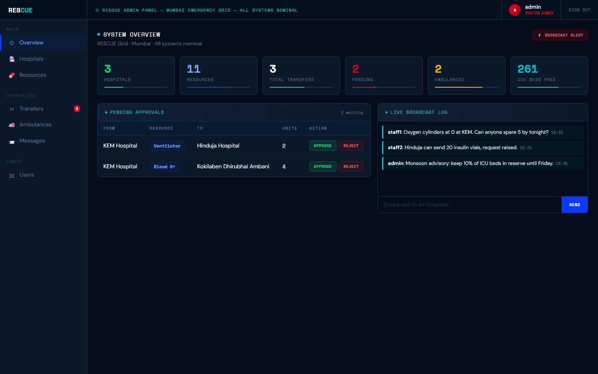
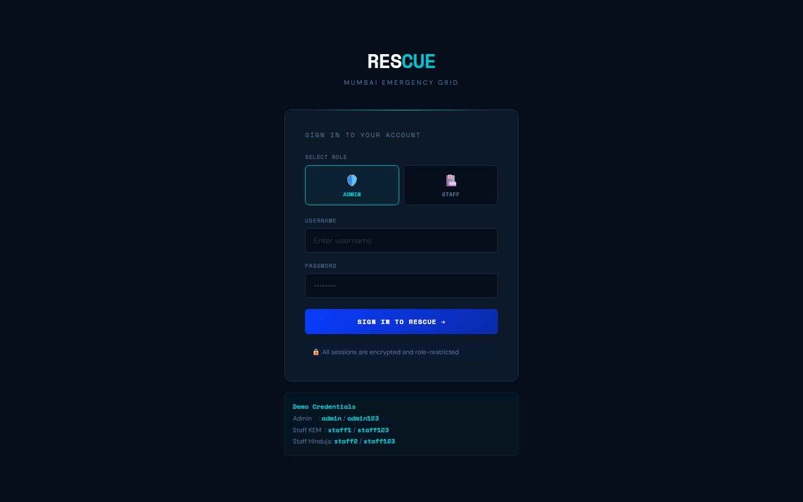
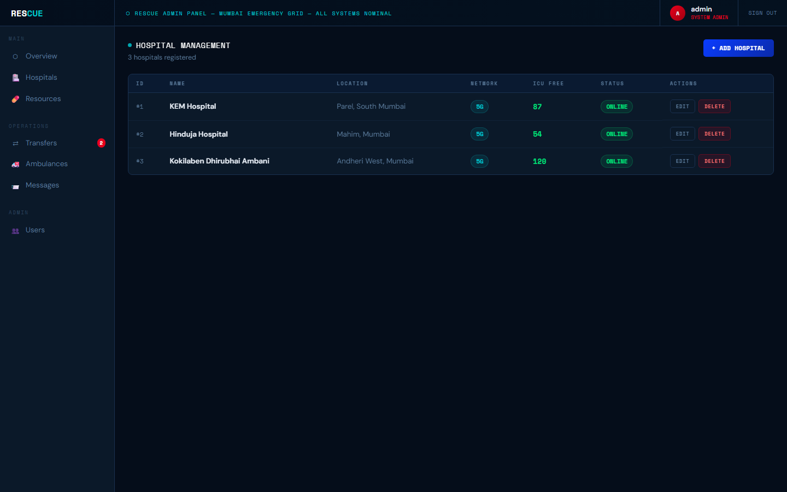
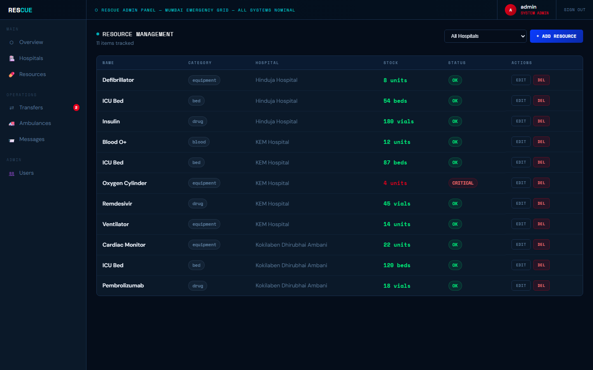
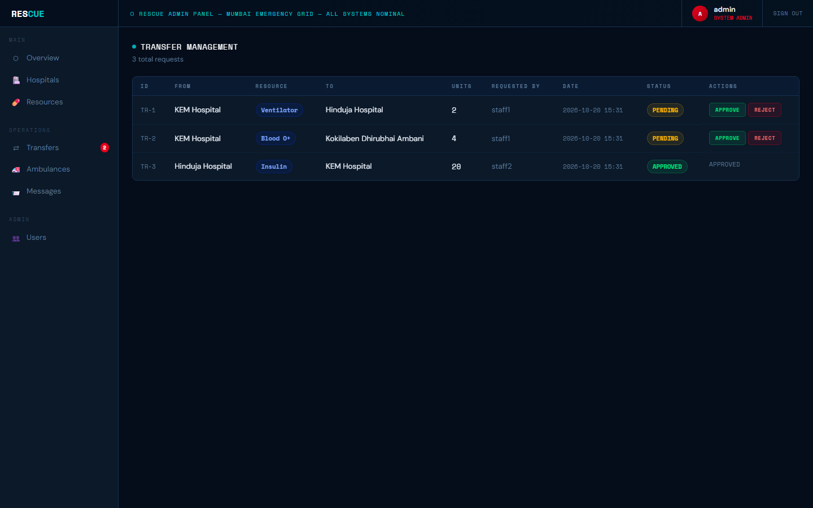
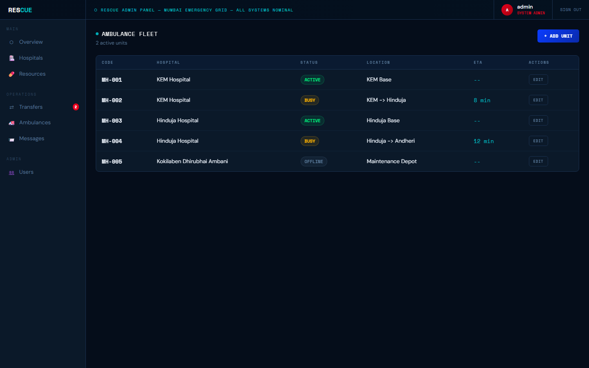
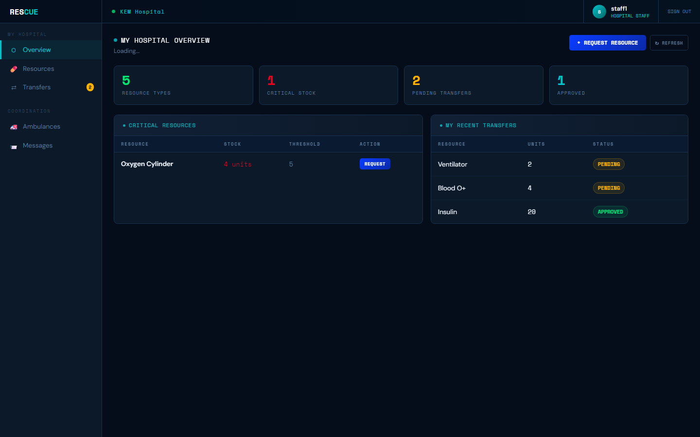
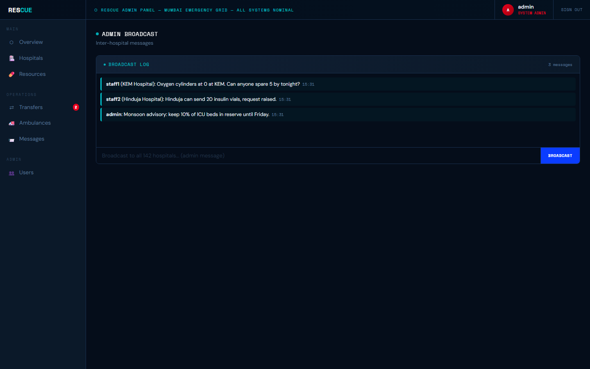

<div align="center">

# 🚑 RESCUE

### Rapid Emergency Services Coordination & Unified Engine

**When one hospital runs out of oxygen and the next one over has twenty cylinders, minutes matter.
RESCUE gives a city's hospitals one shared, live view of beds, blood, drugs and equipment — and a one-click way to move them.**




</div>

---

## The problem it solves

In an emergency, the stock that saves a life usually exists *somewhere* in the city — just not where the patient is.
RESCUE connects hospitals so that:

- every hospital's **ICU beds, blood, medicines and equipment** are visible in real time, with low stock flagged in red;
- a staff member can **request a transfer** from a nearby hospital in seconds;
- a city **admin approves** it, and the stock moves automatically;
- everyone shares one **broadcast channel** for alerts ("keep 10% of ICU beds in reserve") and an **ambulance board**.

## Screenshots

| Sign in (admin or hospital staff) | Hospital network |
|---|---|
|  |  |
| **Resources across the city, critical stock flagged** | **Transfer approvals** |
|  |  |
| **Ambulance fleet** | **Hospital staff view (own hospital only)** |
|  |  |

<details><summary>Broadcast log</summary>



</details>

## Features

| | |
|---|---|
| 🏥 **Hospitals** | Location, network, ICU capacity and free ICU beds |
| 🩸 **Resources** | Beds, blood, drugs, equipment per hospital; anything under its critical threshold is flagged |
| 🔁 **Transfers** | Request → admin approves / rejects → stock is deducted from the source automatically; insufficient stock is refused up front |
| 📣 **Messaging** | City-wide broadcasts and hospital-to-hospital messages |
| 🚑 **Ambulances** | Fleet status (active / busy / offline), location and ETA |
| 🩺 **Triage** | Active cases with P1–P3 priority |
| 🔐 **Roles** | Admin sees and manages everything; staff see only their own hospital — enforced on the server, not in the browser |

## Quick start

You need Python 3 and a running MySQL server.

```bash
pip install -r requirements.txt
copy .env.example .env      # macOS/Linux: cp — then set MYSQL_PASSWORD
python app.py
```

Open **http://localhost:5000**. On the first run RESCUE creates the database, every table and sample data by itself.

| Username | Password | Role | Sees |
|---|---|---|---|
| `admin` | `admin123` | Admin | all hospitals |
| `staff1` | `staff123` | Staff | KEM Hospital |
| `staff2` | `staff123` | Staff | Hinduja Hospital |

Settings (environment or `.env`): `MYSQL_HOST`, `MYSQL_USER`, `MYSQL_PASSWORD`, `MYSQL_DATABASE` (default `rescue_db`), `SECRET_KEY`.

## Under the hood

```
login.html · admin.html · staff.html
          │  static/js/rescue_api.js (fetch, JSON)
          ▼
      app.py — Flask REST API, role checks on every route
          │
      db.py ──► MySQL: users · hospitals · resources · transfers · messages · ambulances · triage
```

- **Database:** seven tables in third normal form with primary, foreign, unique, not-null and check constraints
  (`schema.sql` is the standalone script). Every list joins names in with `INNER JOIN`; the dashboard uses
  `COUNT(*)` / `SUM(icu_available)`; a stock check runs before any transfer is accepted.
- **Security:** passwords hashed with PBKDF2-SHA256, HttpOnly session cookies, role decorators on every route.
- **Frontend:** single-page panels in plain HTML/CSS/JS, no framework; all data via JSON.

<details>
<summary>API reference</summary>

All responses: `{ "success": true, "data": … }` or `{ "success": false, "error": "…" }`

| Method | Path | Who | What |
|---|---|---|---|
| POST | `/api/login` · `/api/logout` | anyone / signed in | Sign in / out |
| GET | `/api/me` | signed in | Current user |
| GET | `/api/admin/stats` | admin | Dashboard counts |
| GET · POST · PUT · DELETE | `/api/hospitals[/<id>]` | admin (GET: all) | Hospitals |
| GET · POST · PUT · DELETE | `/api/resources[/<id>]` | admin (GET: own hospital for staff) | Resources |
| GET · POST | `/api/transfers` | staff / admin | List / request transfers |
| PUT | `/api/transfers/<id>` | admin | Approve, reject or complete |
| GET · POST | `/api/messages` | signed in | Broadcast and direct messages |
| GET · POST · PUT | `/api/ambulances[/<id>]` | admin (GET: all) | Ambulance fleet |
| GET · POST · DELETE | `/api/users[/<id>]` | admin | Users |
| GET · POST | `/api/triage` | signed in | Triage cases |

</details>

<details>
<summary>Course mapping (Web Programming + DBMS labs)</summary>

- **Web:** HTML forms and CSS (login, admin, staff pages), JavaScript validation, `fetch` and live updates without reloads.
- **DBMS:** DDL with all five constraint types, full CRUD, WHERE / ORDER BY / GROUP BY / HAVING and aggregates,
  joins across hospitals, resources, transfers and users, subqueries for stock validation, 3NF across all seven tables.

</details>

---

<sub>Built as a mini project for the Web Programming and Database Management Systems lab courses. Sample hospitals and data are illustrative.</sub>
